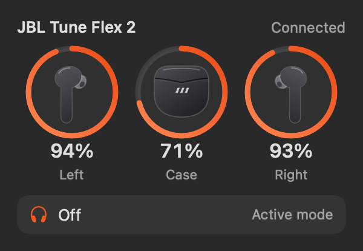

# FlexBar

English · [Türkçe](README.tr.md)

A small macOS menu bar app for the **JBL Tune Flex 2** earbuds. See the battery of each earbud and the case, and switch the noise mode, without picking up your phone.

<p>
  
  
</p>

JBL's own app only runs on phones. FlexBar talks to the earbuds directly over Bluetooth Low Energy, using the same commands the JBL Headphones app sends.

## Features

- **Battery** for the left earbud, right earbud and case, refreshed every minute.
- **Noise mode:** Noise Cancelling, Ambient Aware, TalkThru or Off. A mode is only shown as active once the earbuds confirm it. If they don't confirm within 3 seconds, the panel says so.
- **Noise mode details:** adaptive noise cancelling on or off, and the Ambient Aware level (7 steps).
- **EQ:** Off, Jazz, Vocal or Bass, the JBL app's presets.
- **Smart Audio & Video:** Normal, Audio (higher quality for music) or Video (lower latency for video and calls).
- **Find My Buds:** make the left or right earbud beep.
- **Low battery alerts:** a notification when an earbud reaches 20% and again at 10%. Can be turned off in the gear menu.
- **Connect card:** each time the earbuds connect, a card drops down from the menu bar icon for 4 seconds with battery rings and the active mode.
- **Live updates:** changing the mode with the touch controls on the earbuds updates the menu bar icon and the panel right away.
- **Reconnects by itself** when the earbuds come back in range or leave the case.
- **Open at Login**, from the gear menu.
- **Languages:** English, Türkçe, हिन्दी, Deutsch, Français, Português. Follows the system language; you can pick another one from the gear menu.
- **URL actions** for Shortcuts, Raycast or Terminal:

  ```bash
  open flexbar://anc
  ```

  Also: `flexbar://ambient`, `flexbar://talkthru`, `flexbar://off`, `flexbar://cycle` (next mode), `flexbar://refresh`, `flexbar://panel` (opens the panel), `flexbar://card` (shows the connect card).

## Requirements

- macOS 13 Ventura or later. Built for both Apple silicon and Intel; tested on Apple silicon.
- JBL Tune Flex 2 earbuds, paired with the Mac.

## Install

1. Download **FlexBar.zip** from the [latest release](https://github.com/eensarbas/flexbar/releases/latest).
2. Unzip it and drag **FlexBar** into your **Applications** folder.
3. Open FlexBar. It isn't signed by Apple yet, so macOS blocks the first launch:
   - **macOS 15 Sequoia and later:** macOS says FlexBar wasn't opened. Click **Done**, then open **System Settings › Privacy & Security**, scroll down to **Security** and click **Open Anyway** next to FlexBar. Enter your password and click **Open Anyway** again.
   - **macOS 13 and 14:** right-click FlexBar in Applications, choose **Open**, then click **Open**.

   You only need to do this once.
4. When macOS asks for Bluetooth access, click **Allow**.
5. To start FlexBar with your Mac, click its menu bar icon and turn on **Open at Login** in the gear menu.

If you prefer Terminal, this clears the download flag instead of step 3:

```bash
xattr -dr com.apple.quarantine /Applications/FlexBar.app
```

### Build from source

You need the Xcode Command Line Tools (`xcode-select --install`).

```bash
git clone https://github.com/eensarbas/flexbar.git
```

```bash
cd flexbar && ./build.sh --install
```

This builds the app, copies it to `/Applications` and starts it. `./build.sh --release` makes the same universal `build/FlexBar.zip` that the releases use. The app is ad-hoc signed, so macOS may ask for Bluetooth access again after you rebuild it.

### Releases

Pushing a tag like `v0.2.0` makes GitHub Actions build the universal app and publish it as a release ([workflow](.github/workflows/release.yml)). Pull requests get the same build as a downloadable artifact.

## How it works

The Tune Flex 2 uses a Bestechnic (BES) chip. The JBL app controls it through a GATT service (`65786365-6c70-6f69-6e74-2e636f6d0000`): commands are written to characteristic `…0002` and replies arrive as notifications on `…0001`. There's no encryption.

- Noise mode: `AA 91 …` frames.
- Battery and firmware: `AA 06 …` feature-list frames (`0x1A` left, `0x1B` right, `0x1C` case, `0x05` firmware).

[docs/PROTOCOL.md](docs/PROTOCOL.md) has the frame format, every command FlexBar sends with real replies, and where in the JBL app the rest of the commands live.

To debug, start the app with logging:

```bash
open -n build/FlexBar.app --stdout /tmp/flexbar.log --args --log
```

Add `--snapshot /tmp/panel.png` to save the panel and the connect card as PNGs (dark and light) once battery data arrives.

## Known limits

- Only tested with the JBL Tune Flex 2. Other JBL earbuds built on the same platform (the JBL app lists Vibe Flex 2, Wave Flex 2, Tune Buds 2 and Tune Beam 2 in the same family) may work with small changes, but haven't been tried.
- While FlexBar is connected, the JBL app on your phone may not be able to connect to the earbuds.
- Custom EQ, touch-control settings and the other options in the JBL app aren't supported yet. Their commands are in the JBL app's code; see [docs/PROTOCOL.md](docs/PROTOCOL.md).

## Contributing

Issues and pull requests are welcome, especially:

- **Translations.** All UI text lives in [Resources/translations.py](Resources/translations.py). Edit it and run `python3 Resources/translations.py` to regenerate the `.strings` files. The non-Turkish translations haven't been reviewed by native speakers yet.
- **Other models.** If you have another JBL earbud and can test, please open an issue.
- **More controls** (custom EQ, touch controls) from the protocol notes.

## Disclaimer

FlexBar is an independent project. It is not affiliated with, endorsed by or supported by JBL or Harman International. JBL and Tune Flex are trademarks of Harman International Industries. The protocol was worked out for interoperability; this repository contains no code or assets from JBL or Harman. The earbud and case drawings are original.

Use it at your own risk.

## Credits

Made by Ensar Bas, built together with [Claude](https://claude.com/claude-code).

## License

[MIT](LICENSE)
